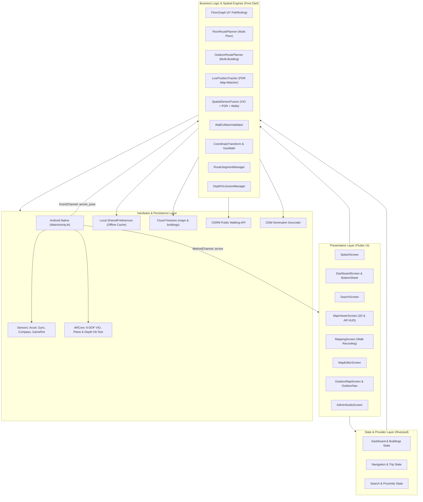
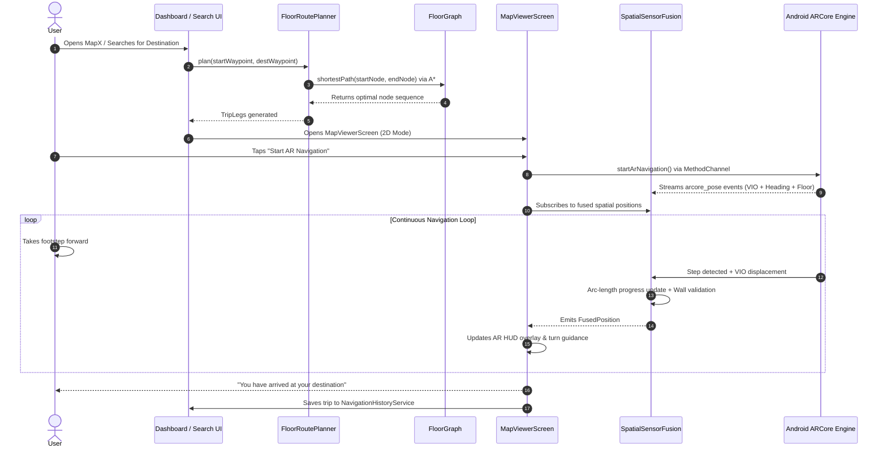
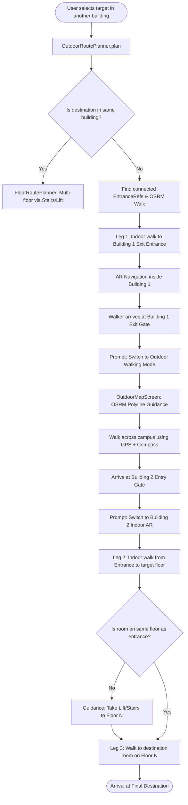
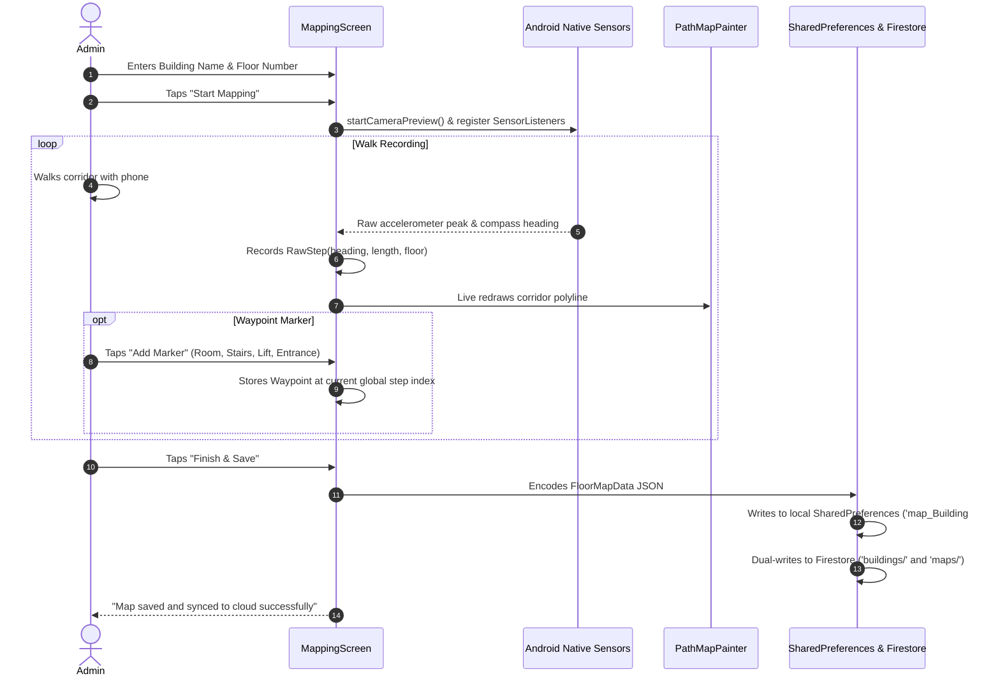
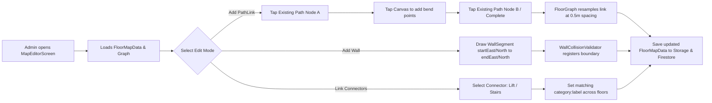

# MapX 2.0 — System Architecture & Complete Codebase Manual

> **Indoor AR Navigation with Sub-Meter Dead Reckoning, Graph-Matched Trajectories, and Multi-Building Outdoor Continuity**

---

## 1. Executive Summary & Product Vision

**MapX 2.0** is an enterprise-grade, infrastructure-free indoor and outdoor navigation system built with **Flutter**, **Android Native ARCore / Sensor Services**, and **Firebase**. Unlike traditional indoor positioning systems that require expensive hardware beacons (BLE iBeacons, Wi-Fi RTT, Ultra-Wideband anchors, or RFID tags), MapX 2.0 operates using standard smartphone sensors:

1. **Pedestrian Dead Reckoning (PDR)**: Inertial accelerometer cadence analysis paired with calibrated human stride modeling.
2. **Visual-Inertial Odometry (VIO) & Spatial Sensor Fusion**: 6-DOF camera pose tracking via Google ARCore combined with low-drift gyroscope and compass orientation.
3. **Map-Matched Route Constraints**: Arc-length snapping along discrete topological floor graphs, preventing lateral drift through walls.
4. **Vertical & Outdoor Continuity**: Graph stitching across building floors using vertical connectors (elevators/stairs) and cross-building campus navigation via OpenStreetMap (OSM) and OSRM walking routes.
5. **Floor-Anchored Augmented Reality HUD**: High-fidelity AR perspective projection overlay that paints directional conduits and waypoints locked to the physical floor plane.

---

## 2. Technology Stack & Dependencies

| Layer / Concern | Technology / Library | Purpose & Scope |
| :--- | :--- | :--- |
| **Framework & Language** | Flutter SDK `^3.11.1` / Dart `3.13+` | Cross-platform core framework, reactive widget tree, rendering engine. |
| **Native Android Core** | Kotlin (`MainActivity.kt`), ARCore SDK, CameraX | Hardware sensor listener, ARCore session lifecycle, 6-DOF VIO pose stream, depth plane hit-testing. |
| **State Management** | `flutter_riverpod: ^2.6.1` | Reactive dependency injection, UI decoupled business state, providers for search, buildings, and navigation. |
| **Vector & Geospatial Math** | `latlong2: ^0.10.1`, Custom `GeoMath` & `CoordinateTransform` | Haversine geodesics, UTM/local metric Cartesian projections, quaternion rotations. |
| **Outdoor GIS & Mapping** | `flutter_map: ^8.3.2`, OpenStreetMap (OSM) Tiles | Offline/online slippy map canvas for campus overview and building footprints. |
| **Outdoor Routing API** | OSRM (Open Source Routing Machine via HTTP) | Real walking footpaths between building entrance coordinates. |
| **Reverse Geocoding** | Nominatim (OpenStreetMap REST API) | Reverse geocoding of GPS coordinates to human-readable street addresses with memory caching. |
| **Cloud Backend & Sync** | `firebase_core: ^4.15.0`, `cloud_firestore: ^6.10.0` | Cloud persistence for building topologies, floor maps, and cross-building links. |
| **Local Offline Storage** | `shared_preferences: ^2.5.5` | Zero-latency offline caching of maps (`map_<building>#<floor>`), connections, saved places, and recent trips. |
| **Design System & Typography**| `google_fonts: ^8.2.1` (Inter), `cupertino_icons: ^1.0.8` | Monochrome Minimal Design System (pure zinc, zero elevation, clean typography). |
| **Animations & Assets** | `lottie: ^3.6.1` | Vector Lottie animation for splash sequence and location warm-up. |

---

## 3. High-Level System Architecture

MapX 2.0 is structured into four distinct, loosely coupled layers:



---

## 4. Native Bridge & Sensor Architecture

### 4.1 Native Platform Channels
The Android platform host communicates with the Flutter engine across two dedicated binary channels:

```
MethodChannel: "mapx/arcore"
EventChannel:  "mapx/arcore_pose"
```

#### MethodChannel Calls (`mapx/arcore`):
* `checkAvailability`: Queries `ArCoreApk.getInstance().checkAvailability(context)` to verify ARCore support and installation status (`SUPPORTED_INSTALLED`).
* `startArNavigation` / `stopArNavigation`: Initializes the ARCore camera session and sensor listeners for full 6-DOF tracking.
* `startCameraPreview` / `stopCameraPreview`: Activates lightweight CameraX preview without full ARCore overhead (used during path mapping).
* `startSession` / `stopSession`: Manages foreground AR session lifecycle.
* `getDetectedWalls`: Extracts planar wall boundaries detected from ARCore vertical planes.
* `isDepthSupported`: Checks whether device hardware supports Google ARCore Depth API.
* `checkDepthOcclusions`: Batches raycasts against depth buffer to test if AR waypoints are visually obstructed by real obstacles.
* `setKeepScreenOn`: Prevents the screen from dimming or locking while navigating.

#### EventChannel Stream (`mapx/arcore_pose`):
Broadcasts high-frequency real-time spatial events containing:
* `heading`: Tilt-compensated magnetometer compass heading in degrees ($0^\circ - 360^\circ$).
* `renderHeading`: Magnetometer-free, gyro-derived heading calculated via `Sensor.TYPE_GAME_ROTATION_VECTOR` with a subtle complementary filter nudging toward magnetic heading. This prevents compass jitter near structural rebar and building electrical conduits.
* `tilt`: Device pitch angle ($90^\circ$ upright, $0^\circ$ flat).
* `motionLevel`: Low-pass filtered dynamic accelerometer variance.
* `vioX`, `vioY`, `vioZ`: Metric 3D translation coordinates from ARCore visual-inertial odometry.
* `vioQx`, `vioQy`, `vioQz`, `vioQw`: 4D quaternion orientation from ARCore camera pose.
* `floorDetected`, `floorHeight`, `floorConfidence`: ARCore horizontal plane ground detection state.
* `arTrackingState`: `TRACKING`, `PAUSED`, or `STOPPED`.

---

## 5. Mathematical Models & Coordinate Transforms

### 5.1 Local Cartesian Metric Grid (East / North)
Indoor floors operate on a local tangent plane measured in meters from an arbitrary datum origin $(0, 0)$:

$$\Delta \text{East} = \sum_{i=1}^n L_i \cdot \sin(\theta_i \cdot \frac{\pi}{180})$$

$$\Delta \text{North} = \sum_{i=1}^n L_i \cdot \cos(\theta_i \cdot \frac{\pi}{180})$$

Where:
* $L_i$: Stride length in meters (default adult human standard: $0.72\text{ m}$).
* $\theta_i$: Direction heading in degrees ($0^\circ = \text{North}$, $90^\circ = \text{East}$).

### 5.2 PDR Step Cadence Filtering
To eliminate false step detection caused by fidgeting or wrist movement, `LivePositionTracker` and `SpatialSensorFusion` apply a dual-peak cadence filter:
* Accelerometer motion threshold: $\ge 0.40\text{ m/s}^2$.
* Inter-step time window: $0.70\text{ s} \le \Delta t \le 1.20\text{ s}$ (mapping) or $0.50\text{ s} \le \Delta t \le 1.40\text{ s}$ (fusion).
* Isolated motion spikes are discarded; steps advance position only when the walker maintains a steady footstep cadence.

### 5.3 Map-Matching Arc-Length Snapping
Rather than freely integrating $(x, y)$ in open space (which causes unbounded lateral drift through walls), user position is projected along the path network:

$$s_{\text{new}} = s_{\text{current}} \pm L_{\text{step}}$$

The reported coordinate $(E, N)$ is interpolated directly from the route polyline at arc-length distance $s$:

$$P(s) = P_k + \frac{s - d_k}{d_{k+1} - d_k} \cdot (P_{k+1} - P_k)$$

This mathematical constraint guarantees that the walker's rendered position remains physically bounded inside mapped corridors.

### 5.4 Perspective Projection for Floor-Anchored AR HUD
In `ArPathPainter`, 3D world coordinates $(X_w, Y_w, Z_w)$ are transformed into 2D camera coordinates $(X_c, Y_c, Z_c)$ using heading $\theta$ and camera pitch $\phi$, then projected onto the screen canvas:

$$\begin{bmatrix} X_c \\ Z_c \end{bmatrix} = \begin{bmatrix} \cos\theta & -\sin\theta \\ \sin\theta & \cos\theta \end{bmatrix} \begin{bmatrix} E - E_{\text{user}} \\ N - N_{\text{user}} \end{bmatrix}$$

$$Y_c = -h_{\text{camera}} \quad (\text{locked to physical floor height})$$

The screen coordinates $(u, v)$ with vertical field-of-view $\alpha$ ($\sim 60^\circ$) and viewport height $H$:

$$f = \frac{H / 2}{\tan(\alpha / 2)}$$

$$u = \frac{W}{2} + f \cdot \frac{X_c}{Z_c}, \quad v = \frac{H}{2} - f \cdot \frac{Y_c}{Z_c}$$

Points behind the camera ($Z_c \le 0.1\text{ m}$) are culled to prevent projection singularity inversion.

---

## 6. End-to-End User Flow Diagrams

### 6.1 End-to-End Indoor Navigation Flow



---

### 6.2 Multi-Floor & Multi-Building Outdoor Continuity Flow



---

### 6.3 Floor Mapping & Admin Walk Recording Flow



---

### 6.4 Map Editor & Topological Link Editing Flow



---

## 7. Deep-Dive Subsystem Breakdown

### 7.1 Graph Representation & A* Pathfinding (`FloorGraph`)
* **File**: `lib/logic/floor_graph.dart`
* **Node Generation**:
  * Walked nodes (`walkNodes`): Generated by integrating recorded step vectors $(\Delta E, \Delta N)$. Node indices match the sequential footstep number.
  * Link nodes: Drawn path segments (`PathLink`) are subdivided at constant spacing:
    $$\Delta s = 0.5\text{ meters}$$
    This maintains uniform node density for AR rendering and allows places to be marked anywhere along added paths.
* **Adjacency & A\* Search**:
  * Directed and undirected edge construction.
  * A* heuristic uses Euclidean distance:
    $$h(n) = \sqrt{(E_n - E_{\text{target}})^2 + (N_n - N_{\text{target}})^2}$$
  * A* guarantees optimal shortest path while expanding fewer nodes than standard Dijkstra. Results are cached in `_pathCache` for zero-latency retrieval.

### 7.2 Multi-Floor Navigation Planner (`FloorRoutePlanner`)
* **File**: `lib/logic/floor_route_planner.dart`
* **Vertical Stitching**:
  * Scans waypoints for `isConnector` (category = `stairs` or `lift`).
  * Matches connectors on different floors using `connectorKey` (`"$category:${label.trim().toLowerCase()}"`).
  * Respects user accessibility preferences (`preferLift = true` prioritizes elevators over stairs).
  * Finds the connector pair that minimizes total combined walking distance across both floors.

### 7.3 Multi-Building Campus Router (`OutdoorRoutePlanner`)
* **File**: `lib/logic/outdoor_route_planner.dart`, `lib/services/routing_service.dart`
* **Campus Stitching**:
  * Matches building entrance waypoints (`isEntrance = true`) associated with real-world WGS84 GPS coordinates (`latitude`, `longitude`).
  * Leverages stored `BuildingConnection` objects generated via OSRM foot routing.
  * Produces an `OutdoorTrip` composed of:
    1. Indoor leg from origin room to building exit entrance.
    2. Outdoor hop along campus footpaths.
    3. Indoor leg from arrival entrance to target destination room.

### 7.4 Spatial Sensor Fusion (`SpatialSensorFusion`)
* **File**: `lib/logic/spatial_sensor_fusion.dart`
* **Fused Metrics**:
  * Fuses 6-DOF VIO translational vectors from ARCore with dead-reckoned step increments.
  * Dynamic stride length calibration: adjusts stride length in real time based on VIO speed when ARCore tracking confidence is high.
  * Wall collision and corridor boundary enforcement: prevents user position estimates from jumping across physical walls mapped in `WallSegment`.
  * Real-time drift detection: compares accelerometer PDR distance against VIO displacement; if divergence exceeds threshold, tracking confidence degrades (`high` $\to$ `medium` $\to$ `low` $\to$ `lost`) and triggers visual realignment UI.

### 7.5 Floor-Anchored AR HUD Engine (`map_viewer_screen.dart`, `ar_path_painter.dart`)
* **Files**: `lib/screens/map_viewer_screen.dart`, `lib/widgets/navigation/ar_path_painter.dart`, `lib/widgets/navigation/ar_mini_map.dart`, `lib/widgets/navigation/off_path_direction_prompt.dart`
* **Features**:
  * Real-time camera overlay with floor plane locking (`floorHeight` hysteresis grace period of 60 frames / ~2 seconds prevents snapping during momentary camera occlusion).
  * 3D floor line rendering: glowing animated chevron conduit drawn directly on the floor surface.
  * Turn-by-turn prompts: computes heading delta between walker orientation and route tangent; displays directional arrows ("Turn Left in 3m", "Turn Right", "Continue Straight").
  * Off-path direction indicator: when the walker turns away from the path ($|\Delta \theta| > 50^\circ$), an intuitive floating 3D chevron points toward the route.
  * Mini-map radar overlay: floating circular 2D preview in screen corner showing walker's heading cone and nearby corridor nodes.

### 7.6 Offline-First Persistence & Dual-Write Cloud Schema
* **Files**: `lib/services/firestore_service.dart`, `lib/services/building_repository.dart`
* **Storage Hierarchy**:
  * Local primary cache: `SharedPreferences` keys:
    * `map_<building>#<floor>`: JSON payload containing segments, steps, waypoints, walls, and links.
    * `building_gps_<building>`: JSON payload of building GPS center.
    * `building_connections`: Serialized list of cross-building OSRM outdoor paths.
    * `navigation_history`: Serialized list of completed `NavigationTrip` items.
    * `saved_places`: Serialized list of bookmarked `SavedPlace` items.
  * Cloud Firestore schema (Dual-Write):
    * `buildings/{buildingName}`: Document with building metadata, GPS coordinates, and `floors[]` array.
    * `buildings/{buildingName}/floors/{floor}`: Subcollection containing floor map data.
    * `maps/{mapKey}`: Top-level mirror collection for fast global queries.
  * Resilient offline design: If network connection is unavailable or Firebase is uninitialized, all operations succeed locally without crashing.

---

## 8. File-by-File Codebase Directory & Role Matrix

### 8.1 Core Logic (`lib/logic/`)

| File | Purpose | Key Exports & Classes | Dependencies |
| :--- | :--- | :--- | :--- |
| `floor_graph.dart` | Topological corridor network representation, link resampling, and A* shortest path search. | `FloorGraph`, `linkNodeSpacing` | `map_models.dart` |
| `floor_route_planner.dart` | Multi-floor routing engine linking floor graphs via stairs and elevators. | `FloorRoutePlanner`, `TripLeg` | `floor_graph.dart`, `map_models.dart` |
| `outdoor_route_planner.dart` | Multi-building router stitching indoor floor legs with outdoor walking hops. | `OutdoorRoutePlanner`, `OutdoorTrip`, `OutdoorHop` | `floor_graph.dart`, `floor_route_planner.dart`, `outdoor_models.dart` |
| `live_position_tracker.dart` | PDR gait analysis and map-matching arc-length position tracking. | `LivePositionTracker`, `LivePosition` | `map_models.dart`, `route_segment_manager.dart` |
| `spatial_sensor_fusion.dart` | Sensor fusion engine merging ARCore 6-DOF VIO, PDR, wall constraints, and drift detection. | `SpatialSensorFusion`, `FusedPosition`, `TrackingConfidence` | `coordinate_transform.dart`, `route_segment_manager.dart`, `wall_collision_validator.dart` |
| `coordinate_transform.dart` | 3D coordinate transformations, quaternion rotations, and camera projection math. | `CoordinateTransform` | `dart:math` |
| `wall_collision_validator.dart`| 2D geometric line-intersection checks preventing route progression through walls. | `WallCollisionValidator` | `map_models.dart` |
| `route_segment_manager.dart` | Arc-length polyline manager, segment indexing, and path tangent interpolation. | `RouteSegmentManager`, `RoutePointProjection` | `map_models.dart` |
| `relocalization_manager.dart` | Heuristic pose realignment at recognized waypoints and floor transitions. | `RelocalizationManager` | `map_models.dart` |
| `depth_occlusion_manager.dart` | Manages ARCore depth buffer occlusion queries to mask virtual paths behind real obstacles. | `DepthOcclusionManager`, `WaypointOcclusionState` | `flutter/services.dart` |
| `floor_transition_manager.dart`| Detects when a user reaches a stairwell/lift and triggers floor switching. | `FloorTransitionManager` | `map_models.dart` |
| `route_instructions.dart` | Generates human-readable turn-by-turn guidance strings from route geometry. | `RouteInstructions`, `InstructionStep` | `map_models.dart` |
| `geo_math.dart` | Geospatial formulas: Haversine distance, initial bearing, cross-track distance. | `GeoMath` | `dart:math` |

---

### 8.2 Data Models (`lib/models/`)

| File | Purpose | Key Models & Types |
| :--- | :--- | :--- |
| `map_models.dart` | Core mapping abstractions: nodes, steps, segments, waypoints, wall boundaries, and links. | `PathNode`, `RawStep`, `PathSegment`, `Waypoint`, `WallSegment`, `PathLink`, `FloorTransition` |
| `floor_map_data.dart` | Model representing an entire saved floor map loaded from storage or cloud. | `FloorMapData` |
| `outdoor_models.dart` | Models for outdoor building connections, entrance references, and GPS coordinates. | `BuildingConnection`, `EntranceRef`, `GeoPoint` |
| `navigation_trip.dart` | Record of a completed navigation session stored in offline trip history. | `NavigationTrip` |
| `saved_place.dart` | Bookmarked location model (building, floor, or specific room). | `SavedPlace`, `SavedPlaceKind` |
| `search_models.dart` | Search index entities: building search summaries, proximity contexts, and waypoint results. | `BuildingSearchInfo`, `SearchWaypointInfo`, `SearchLocationContext` |

---

### 8.3 Services (`lib/services/`)

| File | Purpose | Key Methods / API |
| :--- | :--- | :--- |
| `building_repository.dart` | Aggregates mapped buildings and manages cross-building connections offline and online. | `loadBuildings()`, `saveConnection()`, `deleteConnection()` |
| `firestore_service.dart` | Cloud Firestore sync client handling dual-write building and floor map storage. | `saveBuilding()`, `saveMap()`, `deleteMap()`, `syncFromFirestore()` |
| `location_service.dart` | Device GPS geolocation wrapper using `geolocator`. | `getCurrentLocation()`, `calculateDistance()` |
| `geocoding_service.dart` | Reverse geocoder using OpenStreetMap Nominatim with memory cache. | `reverseGeocode()`, `clearCache()` |
| `routing_service.dart` | Client for OSRM public foot-routing API for outdoor paths. | `getWalkingRoute()` |
| `search_service.dart` | Search indexer performing fuzzy matching and proximity sorting. | `search()`, `buildContext()` |
| `navigation_history_service.dart`| Offline persistence manager for trip logs in `SharedPreferences`. | `getTrips()`, `recordTrip()`, `clearHistory()` |
| `saved_places_service.dart` | Offline persistence manager for favorite places in `SharedPreferences`. | `getSavedPlaces()`, `savePlace()`, `removePlace()` |
| `user_preferences_service.dart` | Stores user settings (prefer lift vs stairs, stride length, UI theme). | `getPreferences()`, `setPreferLift()` |

---

### 8.4 State Management (`lib/providers/`)

| File | Purpose | Key Providers |
| :--- | :--- | :--- |
| `dashboard_providers.dart` | Reactive building catalog, GPS location, active filters, and loading states. | `buildingsProvider`, `userLocationProvider`, `selectedBuildingProvider` |
| `navigation_providers.dart` | Active navigation session, current trip leg, live distance countdown. | `activeTripProvider`, `currentLegIndexProvider` |
| `search_providers.dart` | Search bar query string, active category filter, and real-time search results. | `searchQueryProvider`, `searchResultsProvider` |
| `service_providers.dart` | Dependency injection providers exposing service singleton instances to Riverpod. | `firestoreServiceProvider`, `locationServiceProvider` |

---

### 8.5 UI Screens (`lib/screens/`)

| File | Purpose & User Experience |
| :--- | :--- |
| `splash_screen.dart` | Animated splash entry screen featuring Lottie banner animation, device GPS warm-up, and transition to dashboard. |
| `dashboard_screen.dart` | Home screen displaying mapped buildings, floor cards, GPS proximity badges, search trigger, and bottom action sheet. |
| `search_screen.dart` | Dedicated search experience with category chips (Rooms, Stairs, Lifts, Entrances), recent searches, and instant route buttons. |
| `map_viewer_screen.dart` | Flagship 2D preview and full-screen AR HUD navigation screen with floor tracking, mini-map, and turn prompts. |
| `mapping_screen.dart` | Administrative mapping studio for recording a new floor by walking with real-time compass heading and step detection. |
| `map_editor_screen.dart` | Interactive canvas editor for adding shortcut links (`PathLink`), drawing wall segments, and editing waypoints. |
| `outdoor_map_screen.dart` | OpenStreetMap canvas displaying building footprints, entrance pins, and campus walking paths. |
| `outdoor_navigation_screen.dart` | Turn-by-turn guidance screen for cross-building campus walking between entrance coordinates. |
| `connector_links_screen.dart` | Administrative tool for linking vertical connectors (lifts/stairs) and cross-building entrance pairs. |
| `admin_studio_screen.dart` | Central administrative portal for building metadata management, bulk operations, and diagnostic tests. |
| `preferences_screen.dart` | User settings: accessibility options (`preferLift`), calibrated stride length, and cache management. |
| `recent_trips_screen.dart` | Log of completed trips with timestamp, distance walked, and 1-tap re-navigation. |
| `saved_places_screen.dart` | Bookmarks screen for pinned buildings, floors, and rooms. |
| `location_picker_screen.dart` / `pick_location_screen.dart` | Interactive map coordinate pickers for tagging GPS positions to buildings and entrances. |

---

### 8.6 Widgets & Components (`lib/widgets/`)

| File / Folder | Purpose & Architectural Role |
| :--- | :--- |
| `path_map_painter.dart` | High-performance 2D custom canvas painter that scales and renders floor nodes, walls, and paths. |
| `building_editor_sheet.dart` | Modal bottom sheet for creating or editing building properties and GPS coordinates. |
| `dashboard_bottom_sheet.dart` | Interactive bottom sheet displaying floor lists, building stats, and quick-action shortcuts. |
| `dashboard_sidebar_drawer.dart`| Slide-out navigation drawer providing access to Admin Studio, Preferences, Saved Places, and History. |
| `marker_dialog.dart` | Dialog for dropping and classifying a waypoint during mapping (Room, Stairs, Lift, Entrance). |
| `osm_layers.dart` | Modular tile and marker layers for the `flutter_map` outdoor viewer. |
| `save_place_button.dart` | Bookmark button widget toggling saved status of a building, floor, or room. |
| `navigation/ar_path_painter.dart` | 3D perspective painter projecting virtual path conduits, glow shaders, and destination markers on the floor. |
| `navigation/ar_mini_map.dart` | Corner radar HUD widget displaying user heading cone and real-time orientation relative to the floor plan. |
| `navigation/ar_world_scanner_overlay.dart` | Scanning grid overlay displayed while ARCore detects and locks onto the physical floor plane. |
| `navigation/off_path_direction_prompt.dart`| Floating directional HUD indicator prompting the user to rotate toward the path if facing away. |
| `dialogs/add_floor_dialog.dart` | Modal dialog for attaching a new floor number to an existing building. |
| `dialogs/create_building_dialog.dart` | Modal dialog for registering a new building with name and optional GPS coordinate. |
| `dialogs/confirm_delete_dialog.dart` | Confirmation dialog for permanently deleting buildings or floor plans. |
| `dialogs/delete_path_dialog.dart` | Confirmation dialog for deleting an individual drawn link or segment. |
| `dialogs/discard_changes_dialog.dart` | Prompt warning users of unsaved changes before exiting mapping or editing sessions. |
| `dialogs/join_path_dialog.dart` | Tool for merging two disjoint path nodes during map editing. |

---

## 9. Design System: Monochrome Minimal

MapX 2.0 strictly enforces a **Monochrome Minimal Design System** defined in `lib/main.dart`:

### 9.1 Color Palette
* **Primary / Text**: `Colors.black` (`#000000`)
* **Background Canvas**: `Colors.white` (`#FFFFFF`)
* **Secondary**: `#27272A` (Zinc 800)
* **Body / Deep Neutral**: `#18181B` (Zinc 900)
* **Muted Text / Icons**: `#52525B` (Zinc 600) / `#71717A` (Zinc 500)
* **Hint / Disabled**: `#A1A1AA` (Zinc 400)
* **Borders / Outlines**: `#E4E4E7` (Zinc 200, 1px width)
* **Surface Fills**: `#F4F4F5` (Zinc 100) / `#FAFAFA` (Zinc 50)
* **Destructive Actions Only**: `Colors.red` (used exclusively for Delete / Discard labels)
* **AR Camera Overlays Only**: `Colors.white70` (used for transparent HUD widgets on live video)

### 9.2 Typography & Iconography
* **Typeface**: `GoogleFonts.inter` across all headings, titles, labels, and body text.
* **Weights**: `700` (Headings), `600` (Titles & Button labels), `400` (Body text).
* **Iconography**: `CupertinoIcons` used exclusively across the application for a crisp, refined Apple-grade interface aesthetic (`Icons.stairs_outlined` and `Icons.elevator_outlined` are permitted exceptions where Cupertino equivalents do not exist).
* **Elevation**: Elevation is strictly `0` across cards, dialogs, bottom sheets, and app bars. Depth is created exclusively via 1px zinc borders and contrasting neutral surface fills.

---

## 10. Verification & Test Coverage Matrix

The MapX 2.0 test suite contains **27 pure-Dart test suites** covering logic, planning algorithms, transforms, and UI states without requiring an active ARCore physical device:

| Test Suite File | Domain & Validated Behaviors |
| :--- | :--- |
| `floor_graph_test.dart` | Validates A* pathfinding, distance calculation, link node interpolation, and nearest node queries. |
| `floor_route_planner_test.dart` | Validates multi-floor trip planning, connector key matching, and accessibility lift preferences. |
| `outdoor_test.dart` | Validates cross-building routing, campus entrance linking, and OSRM coordinate stitching. |
| `bidirectional_and_position_tracking_test.dart` | Tests forward/backward step detection, cadence debouncing, and arc-length progress updates. |
| `turn_handling_tolerance_test.dart` | Tests heading delta thresholds, sharp corner transitions, and off-path orientation triggers. |
| `mapping_vio_transform_test.dart` | Tests 3D camera space coordinate transformations and perspective screen projection math. |
| `floor_stats_test.dart` | Validates step counts, corridor metric length calculation, and waypoint counting. |
| `search_service_test.dart` | Validates search indexing, fuzzy keyword queries, room resolution, and proximity sorting. |
| `search_screen_redesign_test.dart` | Tests search screen UI components, category chips, and result tapping. |
| `geocoding_service_test.dart` | Validates Nominatim reverse geocode response parsing and LRU memory caching. |
| `navigation_history_service_test.dart` | Validates recording, reading, and clearing offline navigation trip logs. |
| `saved_places_service_test.dart` | Validates saving, retrieving, and toggling bookmarked buildings, floors, and rooms. |
| `building_edit_test.dart` | Tests building metadata mutation, renaming, and floor addition/removal. |
| `building_delete_immediacy_test.dart` | Validates instantaneous reactive UI removal of deleted buildings from Riverpod state. |
| `dashboard_redesign_test.dart` | Validates dashboard cards, quick action buttons, and empty state rendering. |
| `dashboard_arcore_support_test.dart` | Tests graceful fallback when ARCore is unsupported or running on an emulator. |
| `dialogs_redesign_test.dart` | Tests modal dialog layouts, form inputs, validation errors, and dismissal. |
| `map_editor_screen_test.dart` | Tests canvas editor tap events, link addition, and waypoint repositioning. |
| `map_viewer_redesign_test.dart` | Tests 2D map viewer controls, zoom/pan transforms, and navigation launch button. |
| `ar_navigation_enhancements_test.dart` | Tests AR HUD mini-map projection, world scanner overlay, and floor lock hysteresis. |
| `navigation_system_test.dart` | Comprehensive integration test linking planner, graph, and position tracker. |
| `riverpod_providers_test.dart` | Tests reactive Riverpod provider state changes, filters, and invalidations. |
| `preferences_screen_test.dart` | Tests saving and loading user preference toggles and stride lengths. |
| `admin_studio_screen_test.dart` | Tests administrative studio tools, diagnostic actions, and sync buttons. |
| `splash_screen_test.dart` | Validates splash screen animation lifecycle and navigation push to dashboard. |
| `connector_links_test.dart` | Tests connector link pairing across floors and multi-building connection validation. |
| `widget_test.dart` | Sanity test verifying root `MapXApp` widget tree inflation. |

---

## 11. Build, Execution & Deployment Guidelines

### 11.1 Dependencies & Installation
```bash
# Fetch and resolve dependencies
flutter pub get

# Run static analysis
flutter analyze

# Execute test suite (all 27 pure-Dart suites)
flutter test
```

### 11.2 Physical Hardware Requirements for AR Navigation
* **Device**: Physical Android device with Google Play Services for AR (ARCore) installed.
* **OS**: Android 8.0 (API level 24) or higher.
* **Camera & Sensors**: Accelerometer, gyroscope, and magnetometer (compass) required.
* **Emulators**: Emulators do not support physical ARCore camera feeds or hardware motion sensors; MapX 2.0 detects emulators and displays an informative dialog while keeping 2D map preview fully functional.

### 11.3 Cloud Deployment
* Firebase configuration is managed via `firebase.json` and `lib/firebase_options.dart`.
* Firestore security rules are defined in `firestore.rules`.
* To deploy security rules:
```bash
firebase deploy --only firestore:rules
```
