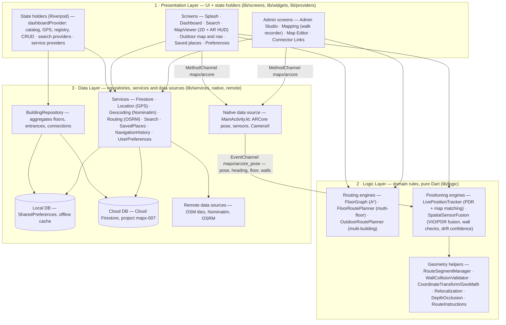
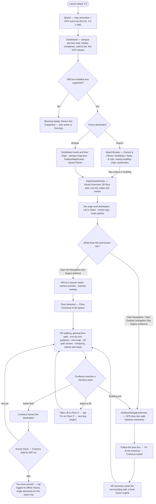
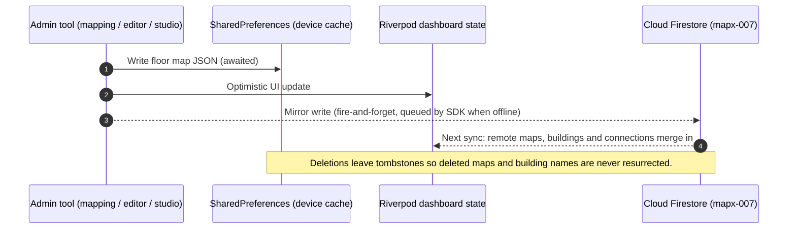

<div align="center">
  
</div>

<h1 align="center">MapX 2.0</h1>

<p align="center">
  <b>Infrastructure-free indoor & outdoor AR navigation</b><br>
  Pedestrian dead reckoning · ARCore spatial fusion · graph-matched routes · floor-anchored AR HUD
</p>

<p align="center">
  
  
  
  
</p>

---

MapX 2.0 is a Flutter + Firebase campus navigation app that guides users through **indoor corridors, across floors, and between buildings** using nothing but a standard Android phone's sensors and camera. No BLE beacons, no Wi-Fi RTT, no UWB anchors.

- **How it locates you** — Pedestrian Dead Reckoning (step cadence + stride model) fused with ARCore 6-DOF visual-inertial odometry, then constrained to the mapped corridor graph by arc-length map matching so the rendered position cannot drift through walls.
- **How it guides you** — A floor-anchored AR HUD paints the route directly onto the floor plane, with turn-by-turn prompts, an off-path correction chevron, a mini-map radar, and a remaining distance/steps bar.
- **How it continues** — Stairs and lifts stitch floors together; OSRM walking routes stitch buildings together; the outdoor map (pure OpenStreetMap tiles) covers the campus in between.
- **How maps get made** — An admin walks each corridor once with the phone (ARCore-recorded), drops room/stairs/lift/entrance markers, edits the path network on a 2D canvas, and links buildings. Everything is stored locally first, then mirrored to Cloud Firestore.

---

## Table of contents

1. [Feature highlights](#feature-highlights)
2. [System architecture](#system-architecture)
3. [User flow — normal user](#user-flow--normal-user)
4. [User flow — admin / map author](#user-flow--admin--map-author)
5. [System requirements](#system-requirements)
6. [Constraints & known limitations](#constraints--known-limitations)
7. [Tech stack](#tech-stack)
8. [Project structure](#project-structure)
9. [Getting started](#getting-started)
10. [Testing](#testing)
11. [Data model & security](#data-model--security)
12. [Documentation map](#documentation-map)

---

## Feature highlights

### For users

| Feature | Description |
| :--- | :--- |
| **Splash warm-up** | Animated logo (~2.4 s) runs in parallel with the first GPS fix; a 3.5 s cap guarantees the dashboard always opens. |
| **Live campus dashboard** | Full-screen OpenStreetMap preview with building pins, entrance pins, connection lines and a live user dot; floating header, locating indicator, and a draggable bottom sheet (40% / 62% / 95%). |
| **Campus directory** | Buildings sorted nearest-first with floor chips, walking distance, OSM place names, and a "N complexes near you" count within 1 km. |
| **Search** | Places & Rooms / Buildings / Stairs & Lifts filters, nearby-building focus chips, "Show All" escape hatch, saved-place bookmarks on every result, and direct routing from a result tap. |
| **Route overview (2D)** | Zoomable floor-plan canvas with floor selector (F0/F1/B1 …), 1 m grid, turn instruction list, step/metre/level metrics, and an origin/destination place picker across all linked buildings. |
| **Accessible route options** | Lift vs Stairs preference (persisted), planned-leg summary, and a **Sensor AR Navigation (without ARCore)** fallback mode. |
| **AR navigation** | Floor-plane detection with scanner overlay, glowing path locked to the floor, guidance banner ("Turn right in 8 m", "Continue straight"), collapsible mini-map, off-path "TURN LEFT 42°" prompts, drift/relocalization banner, and a distance bar (remaining m · steps left · total m). |
| **Multi-floor trips** | At a stairs/lift waypoint guidance switches to "Take Lift to Floor 2"; one tap on **"I'm on Floor 2"** advances the leg and reopens the camera. |
| **Multi-building trips** | At the building exit, **"Walk outside"** opens the outdoor navigation screen (GPS blue line, off-route warning) and **"I'm at the entrance" → "Continue inside"** resumes AR in the next building. |
| **Outdoor map** | Campus-wide map with per-building sheets (floors, entrances, linked buildings with walk times), three basemap styles, and "My location" recenter. |
| **Saved places** | Bookmark buildings, floors or specific rooms from search, the dashboard or the campus map; offline-only, swipe to delete. |
| **Trip history** | Confirmed arrivals are logged automatically (origin, destination, distance, time) and kept offline; the history list UI is not yet wired into navigation (see constraints). |
| **Preferences** | Default basemap theme (Standard OSM / Dark Blue / Monochrome Light), metric units, local storage status. |

### For admins / map authors

| Feature | Description |
| :--- | :--- |
| **Admin Studio** | Single hub for walk-recording, floor management, building metadata, connector links, and live counts ("N Buildings · N Floors · N Nodes · N Places"). |
| **Walk & record a floor** | ARCore VIO drops a graph node every 0.5 m (PDR fallback when VIO is unavailable), auto-splits segments at corners, and suppresses in-place device adjustments. |
| **Marker capture** | Place / Stairs / Lift / Entrance waypoints; entrances capture GPS (current fix or map pick) and connector names are suggested from other floors so multi-floor linking just works. |
| **Floor map editor** | Places mode (tap the path to add, tap a marker to rename/re-categorize/delete) and Paths mode (draw shortcut links between places, or walk a new branch path and join it to an existing node — or leave it a dead end). |
| **Building links** | Tap two building pins in Connector Links; the closest entrance pair is routed over OSRM footpaths and stored as a `BuildingConnection` (real route, or a haversine straight-line fallback). |
| **Floor lifecycle** | Custom floor labels, floor renumbering, and deletes that migrate or drop affected waypoints and connector links, with cloud tombstones so other devices don't resurrect deleted data. |
| **Building metadata** | Rename buildings (migrates local keys, GPS cache, connections and Firestore docs), set/update GPS (live fix, map pin, or manual entry), delete buildings. |

### Platform-level

- **Offline-first**: every map, connection, saved place and trip lives in `SharedPreferences`; Firestore is a mirror. All cloud calls fail soft and never block the UI.
- **Monochrome-minimal design system**: black/white/zinc palette, 1 px borders, zero elevation, Inter typography, Cupertino icons — enforced from the `ThemeData` in `lib/main.dart`.
- **Resilient native bridge**: ARCore, sensors and CameraX are exposed over one MethodChannel + one EventChannel; `MissingPluginException` is tolerated so tests and desktop builds run headless.

---

## System architecture

MapX 2.0 uses a classic **three-tier architecture — Presentation, Logic and Data** — with a one-way dependency direction: the UI renders, the domain engines compute, and the data layer reads and writes. **Riverpod is the state-management mechanism inside the presentation tier (state holders, like ViewModels) — it is not a layer of its own.**



> The three tiers share the JSON-serializable types in `lib/models` (`PathNode`, `Waypoint`, `PathLink`, `FloorMapData`, `BuildingConnection`…). `navigationProvider` models the navigation session (floor, legs, AR mode, confidence) but is currently exercised only by the test suite; `MapViewerScreen` holds the live session state locally.

### Layer responsibilities

| Layer | Location | Responsibility |
| :--- | :--- | :--- |
| **1 · Presentation** | `lib/screens`, `lib/widgets`, `lib/providers` | Renders the UI (15 screens, AR HUD painters, sheets, dialogs) and holds derived state. The Riverpod providers are the *state holders* — `dashboardProvider` owns the building catalog, GPS and registry, applies optimistic CRUD, and reconciles through `loadMaps()`. Contains no positioning math. |
| **2 · Logic** | `lib/logic` | Pure Dart, zero Flutter and zero service dependency: `FloorGraph` (A* on 0.5 m-resampled links), `FloorRoutePlanner` (connector stitching), `OutdoorRoutePlanner` (building hops), `LivePositionTracker` (PDR + arc-length snapping), `SpatialSensorFusion` (VIO/PDR fusion, wall checks, drift confidence), plus geometry, relocalization, occlusion and turn-instruction helpers. |
| **3 · Data** | `lib/services`, native, remote | Repositories and services own all I/O: `BuildingRepository`, Firestore sync, GPS, Nominatim geocoding, OSRM routing, search, saved places, trip history and preferences. Behind them sit the data sources: `SharedPreferences` (local DB), Cloud Firestore (cloud DB), `MainActivity.kt` (ARCore/sensors) and the OSM endpoints. All calls fail soft (`debugPrint`), so callers check return values instead of catching throws. |

### Native bridge (Android)

The entire native surface is two channels, `MethodChannel('mapx/arcore')` and `EventChannel('mapx/arcore_pose')` (~30 fps). Handle `MissingPluginException` on non-Android platforms and in tests.

| MethodChannel call | Purpose |
| :--- | :--- |
| `checkAvailability` | ARCore installation state (`SUPPORTED_INSTALLED` required). Retries transient answers up to 5 times. |
| `startSession` / `stopSession` | Foreground AR session lifecycle (requests camera permission, starts the pose loop, keeps the screen awake on demand). |
| `startArNavigation` / `stopArNavigation` | Full ARCore `ArSceneView` with horizontal/vertical plane detection and Depth API enabled when supported. |
| `startCameraPreview` / `stopCameraPreview` | Lightweight CameraX preview for the sensor-only navigation mode (no SLAM). |
| `isDepthSupported` | Whether the device supports the ARCore Depth API. |
| `checkDepthOcclusions` / `checkObstruction` | Batched depth-buffer tests that hide AR waypoints behind real obstacles. |
| `getDetectedWalls` | Vertical plane boundaries detected by ARCore. |
| `setKeepScreenOn` | Screen wake-lock during navigation and recording. |

The EventChannel payload carries: VIO translation (`x/y/z`) and quaternion (`qx..qw`), fused `heading`, magnetometer-free `renderHeading` (game rotation vector + complementary filter), `tilt`, `motion`, `floorDetected/floorHeight/floorConfidence`, `cameraFovY`, `arTrackingState`, `trackingFailureReason`, depth flags, and detected walls.

### How positioning works (in one page)

1. **Calibration** — the first tracked ARCore pose locks the AR frame to map north (`CoordinateTransform.calibrate`).
2. **Step detection** — accelerometer peaks ≥ 0.4 m/s² within a 0.7–1.2 s cadence window; isolated spikes are discarded.
3. **Map matching** — progress advances by arc length along the route polyline (`s ± stride`), and the reported position is interpolated on the polyline, so the dot walks corridors instead of floating through walls.
4. **Fusion** — 6-DOF VIO displacement is blended with PDR; stride length self-calibrates from VIO speed (85/15 blend); wall collisions veto jumps; divergence between PDR and VIO degrades confidence (`high → medium → low → lost`) and triggers a relocalization banner.
5. **Arrival** — five concurrent factors (≤ 1.2 m spatial error, ≤ 1.5 m along-route error, line-of-sight clear, reliable tracking, walked ≥ 0.8 m) held for 800 ms.
6. **AR projection** — world (east/north) coordinates are rotated into camera space by heading/pitch and perspective-projected onto the floor plane with the device's vertical FOV; points behind the camera (≤ 0.1 m) are culled.

### Persistence & cloud sync

| Store | Key / path | Content |
| :--- | :--- | :--- |
| Local | `map_<building>#<floor>` | Floor payload: segments, steps, waypoints, walls, links, step count, GPS. |
| Local | `building_registry`, `building_gps_<name>`, `building_place_<name>` | Known buildings (incl. zero-floor), GPS fix, cached OSM place name. |
| Local | `building_connections` | Serialized `BuildingConnection` list (OSRM routes between entrance pairs). |
| Local | `mapx_saved_places_v1`, `mapx_navigation_history_v1`, `mapx_prefs_*` | Saved places, trip logs, user preferences. |
| Cloud | `buildings/{name}` | Metadata, GPS, `floors[]`, `renamedFrom`. |
| Cloud | `buildings/{name}/floors/{floor}` | Same payload as the `maps` doc (subcollection mirror). |
| Cloud | `maps/{mapKey}` | Global mirror for fast queries. |
| Cloud | `connections/{id}` | Cross-building walking connections. |
| Cloud | `deleted_buildings/{name}` | Tombstones so deletes don't resurrect during sync. |

Writes are **local-first**: `SharedPreferences` first (awaited), Riverpod optimistic update, then a fire-and-forget Firestore mirror. Sync-down pulls tombstones, remote `maps/*` and `buildings/*`, updating the local cache only when content changed, and never resurrecting device-deleted names.

---

## User flow — normal user

From launch to arrival, including multi-floor and multi-building trips:



Key behavior worth knowing: if two buildings were never linked by an admin, the Route Options sheet explains that (instead of silently routing) and tells the user the buildings "aren't linked". The **Sensor AR Navigation (without ARCore)** option in Route Options provides a fallback guidance mode.

---

## User flow — admin / map author

Admins build the world the users navigate — one walk per corridor, then edits and links:

```mermaid
flowchart TD
    StudioEnt["Admin Studio — from the dashboard drawer (currently not access-controlled)"] --> NewFloor["Walk & Record New Floor — building name + floor number, live GPS tag"]
    NewFloor --> WalkRec["MappingScreen — walk the corridor: ARCore VIO drops a node every 0.5 m (PDR fallback when VIO is weak)"]
    WalkRec --> Tag["Add Place / Stairs / Lift / Entrance markers — entrances capture GPS; connector names suggested from other floors"]
    Tag --> More{"More corridor to cover?"}
    More -- "Yes" --> WalkRec
    More -- "Finish & Save" --> SaveCheck{"Any steps recorded?"}
    SaveCheck -- "No — empty map" --> WalkRec
    SaveCheck -- "Yes" --> SaveLocal["Save: SharedPreferences per-floor JSON first, Firestore mirror second (dual-write)"]
    SaveLocal --> Edit["MapEditorScreen — Places mode and Paths mode"]
    Edit --> LinkPaths["Draw shortcut path links between places, or walk a branch path; join it within 3 m of an existing node or leave a dead end"]
    Edit --> ManagePlaces["Rename / re-categorize / delete places · delete links (orphaned waypoints pruned)"]
    LinkPaths --> SaveEdit["Save — local-first, Firestore mirror, graph rebuilt"]
    ManagePlaces --> SaveEdit
    SaveEdit --> Connect["ConnectorLinksScreen — tap building A, then building B"]
    Connect --> EntranceCheck{"Both buildings have an Entrance with GPS?"}
    EntranceCheck -- "No" --> FixEntr["Dialog: add an Entrance with GPS in the editor, then retry"]
    EntranceCheck -- "Yes" --> Pair["Closest entrance pair auto-picked (dropdown if multiple) → OSRM foot route requested"]
    Pair --> RouteOk{"OSRM returned a route?"}
    RouteOk -- "Yes" --> SaveConn["BuildingConnection saved — SharedPreferences + Firestore"]
    RouteOk -- "No / error" --> Straight["Fallback: straight-line connection (haversine distance at about 1.3 m/s)"]
    Straight --> SaveConn
    SaveConn --> FloorOps["Floor lifecycle — rename label · move / renumber floor · delete floor or building; maps, waypoints and links migrate or are dropped, tombstones keep other devices in sync"]
```



Data flow during any admin save (local-first, cloud-mirrored):



---

## System requirements

### Runtime — end-user device

| Area | Requirement |
| :--- | :--- |
| **OS** | Android 8.0 (API level 24) or newer — `minSdk = 24` in `android/app/build.gradle.kts`. |
| **AR support** | A **physical, ARCore-certified device with Google Play Services for AR installed** (`checkAvailability == SUPPORTED_INSTALLED`). The manifest declares `android.hardware.camera.ar` as required, and the app exits with a blocking "Device Not Supported" dialog on anything else — **emulators are unsupported by design**. |
| **Sensors** | Accelerometer (step detection), gyroscope + magnetometer via `TYPE_GAME_ROTATION_VECTOR` (heading), camera (AR / preview). |
| **Location** | GPS / location services for proximity badges, entrance tagging, campus map and outdoor walking (`ACCESS_FINE_LOCATION`, `ACCESS_COARSE_LOCATION`). |
| **Camera** | Required — `CAMERA` permission; requested at runtime on first AR session. |
| **Depth API** | Optional. When the device supports ARCore Depth, AR waypoints occluded by real obstacles are dimmed; otherwise the path draws unoccluded. |
| **Connectivity** | Any — navigation works fully offline from cached maps. Online is needed for cloud sync, first-time place names, OSM basemap tiles and outdoor walking views. |
| **Storage** | A few MB — floor maps are compact JSON in `SharedPreferences`. |
| **Screen** | Kept awake during AR navigation and walk recording (auto-release after ~8 min of inactivity). |

### Development environment

| Requirement | Detail |
| :--- | :--- |
| **Flutter / Dart** | Flutter SDK with Dart `^3.11.1` (repo verified on Flutter 3.47 / Dart 3.13). |
| **Android toolchain** | JDK 17 (`sourceCompatibility = 17`), Android SDK with the platform used by `flutter.compileSdkVersion`. |
| **Native libraries** | Resolved by Gradle: ARCore `1.56.0`, SceneView `0.10.0`, CameraX `1.3.4`, Guava `33.4.0`. |
| **Firebase** | Project `mapx-007`, wired through `firebase.json` → `lib/firebase_options.dart` + `android/app/google-services.json`. Optional for local-only development (all cloud calls fail soft). |
| **Firebase CLI** | Optional: `firebase deploy --only firestore:rules`, `flutterfire configure` to regenerate wiring. |
| **Test device** | A physical ARCore-capable Android device for AR flows. The pure-Dart test suite needs no device. |

### External network services

| Service | Endpoint used | Role |
| :--- | :--- | :--- |
| **OpenStreetMap tiles** | `tile.openstreetmap.org` | Outdoor basemaps in three visual styles (standard OSM, dark navy, monochrome light) via GPU color-filter matrices; attribution shown per ODbL. |
| **OSM Nominatim** | `nominatim.openstreetmap.org/reverse` | Reverse geocoding building / place names. Memory + persistent cache with 30-day / 100 m staleness rules; requests serialized ≥ 1.1 s apart. |
| **OSRM (FOSSGIS)** | `routing.openstreetmap.de/routed-foot` | Walking routes between building entrances, requested only while an admin links buildings. The resulting polyline is stored, so navigation never calls OSRM again. |
| **Cloud Firestore** | project `mapx-007` | Shared cloud mirror of maps, buildings, connections; tombstones for deletes. |

> All three OSM services are free public endpoints without API keys or SLAs — see the constraints below before scaling usage.

---

## Constraints & known limitations

### Security & access control

- **No authentication, and admin tools are not gated.** There is no `firebase_auth` dependency anywhere in the project. The "Admin Studio" card in the drawer is labelled `ADMIN ONLY`, but it is reachable by any user; the label is decorative.
- **Firestore rules are fully open**: `allow read, write: if true;` for every document (`firestore.rules`). Anyone with the app can create, edit or delete buildings, floors and connections in the shared `mapx-007` project. The RBAC schema from earlier planning documents is **not implemented and not deployed** — do not describe the app as access-controlled.
- Admin tools only require the same device capabilities as the app itself; no separate admin build or login exists.

### Platform & hardware

- **Android-only in practice.** The AR bridge (`MainActivity.kt`, ARCore, CameraX) exists only for Android. The iOS/macOS/Windows/web folders are Flutter scaffolding with Firebase config entries, but `MethodChannel('mapx/arcore')` calls resolve to `MissingPluginException` there, so AR/recording flows are unavailable. iOS `Info.plist` also lacks camera/location usage descriptions.
- **ARCore-certified device mandatory.** An unsupported device (including every emulator) gets a non-dismissible "Device Not Supported" dialog whose only action is *Exit App*. This is intentional — there is no degraded whole-app mode; the only fallback is the in-nav "Sensor AR Navigation (without ARCore)" mode, which itself still requires Android camera + sensors.
- Because the manifest marks `camera.ar` as required, Play Store distribution would only target AR-capable devices.
- **Release signing is not configured** — `android/app/build.gradle.kts` still signs with debug keys (`TODO` in the file). The applicationId is `com.example.mapx2`, intentionally distinct from the older prototype so both can coexist on a device.

### Sensing & accuracy

- **No absolute indoor positioning.** Location has no beacon or fingerprint anchor; drift is *bounded* by map matching, not eliminated. Accuracy depends on corridor-map quality, device sensors, and environment (lighting/texture for VIO, magnetic interference — mitigated by the gyro-derived render heading).
- Tracking confidence degrades `high → medium → low → lost` when PDR and VIO diverge; the UI surfaces a relocalization banner, and guidance may pause until the user is re-anchored.
- PDR fallback uses a fixed 0.72 m default step length; stride self-calibrates only while VIO tracking is healthy.
- Depth-based occlusion requires ARCore Depth support (not all devices).

### Map authoring

- **Walls cannot be drawn in the app.** Walk recording always persists `walls: []`, and the editor offers Places and Paths modes only. `WallCollisionValidator` is fully implemented but only effective on maps that contain wall geometry from some other source.
- **Vertical connectors link by name, not by ID.** Stairs/lifts on different floors are joined when their `category:label` key matches (e.g. `lift:lift a`). The marker dialog suggests names already used on other floors, but a typo silently splits the stairwell — the planner then reports "no vertical connection available".
- Building-to-building links require at least one **Entrance with GPS** per building; without one, Connector Links shows an explanatory dialog instead of linking.
- New links require network at creation time (OSRM). The straight-line fallback covers routing failures, but it may cut across real obstacles.
- **Saved places, trip logs and preferences are device-local** (`SharedPreferences`); there is no account and no cross-device sync for user data.
- **Trip history has no entry point.** Arrivals are logged to `NavigationHistoryService`, but the `RecentTripsScreen` is currently unreachable from the navigation UI.

### Data & sync

- **Last-write-wins per document.** `syncFromFirestore` overwrites the local cached copy whenever the remote JSON differs, so concurrent edits on two devices can silently overwrite each other. There is no merge, versioning, or conflict UI.
- Deletions use tombstones (`deleted_buildings/*`, `map_tombstone_*`) to avoid resurrecting removed data; a device that has been offline for a long time still receives the tombstone on next sync.
- **All Firestore failures are swallowed** (`debugPrint` only). The UI never shows sync errors — "saved" always means "saved locally"; cloud copy status is best-effort.

### Network & third-party services

- OSM tile, Nominatim and OSRM usage relies on free public endpoints subject to their usage policies — heavy or commercial usage requires self-hosted or commercial equivalents. There are no API keys, quotas or SLAs configured.
- No offline basemap caching: outdoor map views need connectivity (OSM tiles are fetched on demand, though a static screen cache makes re-entry within a session fast).
- Nominatim reverse geocoding is aggressively cached and serialized to respect fair-use policy, but place names may be stale (30-day / 100 m staleness rules).

### Design & code constraints (repo conventions)

- **Monochrome-minimal design system is mandatory** for every new/edited screen: black/white + zinc neutrals, 1 px `#E4E4E7` borders, zero elevation, radius 12–18, Inter typography, Cupertino icons. `Colors.red` is allowed only for destructive text; `Colors.white70` only for AR camera overlays. Source of truth: `ThemeData` in `lib/main.dart`.
- **Units are metric-only.** Preferences force-write meters on open; the imperial setting exists in code but is not exposed.
- Tests must remain pure-Dart — AR/native paths are mocked or skipped via `MissingPluginException`; the suite must not require a device.

---

## Tech stack

| Layer | Technology | Purpose |
| :--- | :--- | :--- |
| Framework | Flutter (Dart `^3.11.1`) | Cross-platform UI, single codebase, custom canvas rendering. |
| Native | Kotlin, ARCore 1.56, SceneView 0.10, CameraX 1.3.4 | 6-DOF VIO, plane/depth hit-tests, sensor listeners, camera preview. |
| State | `flutter_riverpod ^2.6.1` | Reactive DI and UI state (dashboard, search, services). |
| Maps | `flutter_map ^8.3.2`, OpenStreetMap tiles | Outdoor campus map, building pins, connection polylines. |
| Geospatial | `latlong2 ^0.10.1`, custom `GeoMath` / `CoordinateTransform` | Haversine geodesics, local metric grid, quaternion/camera math. |
| Cloud | `firebase_core ^4.15.0`, `cloud_firestore ^6.10.0` | Shared map/building/connection storage. |
| Local storage | `shared_preferences ^2.5.5` | Offline-first cache for everything. |
| Location | `geolocator ^14.1.1` | GPS fixes, permission flow, position stream. |
| Network | `http ^1.6.0` | Nominatim + OSRM clients. |
| UI | `google_fonts ^8.2.1` (Inter), `cupertino_icons ^1.0.8`, `lottie ^3.6.1` | Monochrome typography, icons, splash animation. |

---

## Project structure

```
lib/
├── main.dart                     # Firebase init + ThemeData (monochrome system) + SplashScreen
├── firebase_options.dart         # FlutterFire-generated config (project mapx-007)
├── logic/                        # Pure-Dart spatial engines (no Flutter imports)
│   ├── floor_graph.dart          # Topological graph + A* (0.5 m link resampling)
│   ├── floor_route_planner.dart  # Multi-floor trips via stairs/lift connector keys
│   ├── outdoor_route_planner.dart# Multi-building trips (indoor leg + outdoor hop + indoor leg)
│   ├── live_position_tracker.dart# PDR step detection + arc-length map matching
│   ├── spatial_sensor_fusion.dart# VIO + PDR fusion, stride calibration, drift confidence
│   ├── route_segment_manager.dart, wall_collision_validator.dart, coordinate_transform.dart
│   ├── geo_math.dart, relocalization_manager.dart, floor_transition_manager.dart
│   ├── depth_occlusion_manager.dart, route_instructions.dart
├── models/                       # JSON-serializable types (maps, outdoor, trips, saved places, search)
├── providers/                    # Riverpod: dashboard state (1040 lines), search, services
├── screens/                      # 15 screens (splash, dashboard, search, viewer, editor, admin tools…)
├── services/                     # Firestore, location, geocoding, routing, search, history, saved places, prefs
└── widgets/                      # Painters, sheets, dialogs, and navigation/ AR HUD components
assets/images/                    # banner.png (this README), app icon source, in-app banner art
assets/animations/                # Lottie splash / scanning animation
android/app/src/main/kotlin/com/example/mapx/MainActivity.kt  # ARCore + sensor bridge (847 lines)
test/                             # 30 device-free suites (~170 tests)
firestore.rules                   # Currently open-rules (see constraints)
firebase.json                     # Firestore rules + FlutterFire platform wiring
```

---

## Getting started

### Prerequisites

- Flutter SDK (Dart `^3.11.1`), JDK 17, Android SDK.
- A physical ARCore-capable Android device (an emulator cannot run AR flows and will show the unsupported dialog by design).
- Optional: Firebase CLI + access to the `mapx-007` project.

### Build & run

```bash
flutter pub get                 # Install dependencies
flutter analyze                 # Lint (flutter_lints, repo passes clean)
flutter test                    # Full pure-Dart suite (no device needed)
flutter run                     # Deploy to a connected ARCore device
```

### Firebase

```bash
# Regenerate firebase wiring if config changes (writes lib/firebase_options.dart + google-services.json)
flutterfire configure

# Deploy Cloud Firestore rules
firebase deploy --only firestore:rules
```

> ⚠️ The deployed rules are currently `allow read, write: if true` — the rules are for a development/demo backend, not a production authorization model.

---

## Testing

The suite is **30 files / ~170 test cases** covering planning, tracking, services, state and UI — deliberately device-free: AR/native paths are mocked or skipped when `MethodChannel('mapx/arcore')` is missing.

| Group | Suites (examples) | Validates |
| :--- | :--- | :--- |
| Planning | `floor_graph_test`, `floor_route_planner_test`, `outdoor_test`, `inter_building_navigation_test` | A* paths, connector matching, lift preference, multi-building stitching. |
| Tracking & fusion | `bidirectional_and_position_tracking_test`, `turn_handling_tolerance_test`, `navigation_system_test`, `mapping_vio_transform_test` | Step cadence, arc-length progress, heading tolerance, projection math. |
| Services | `search_service_test`, `geocoding_service_test`, `navigation_history_service_test`, `saved_places_service_test`, `location_service_test` | Indexing, caching, persistence, GPS parsing. |
| UI & state | `dashboard_redesign_test`, `map_viewer_redesign_test`, `search_screen_redesign_test`, `admin_studio_screen_test`, `connector_links_test`, `riverpod_providers_test`, `splash_screen_test` | Widget structure, navigation, provider reactivity. |
| Admin edits | `building_edit_test`, `building_delete_immediacy_test`, `map_editor_screen_test`, `dialogs_redesign_test` | Rename/renumber/delete propagation, editor taps, dialog flows. |
| Hardware fallback | `dashboard_arcore_support_test` | Graceful handling of unsupported ARCore / emulators. |

```bash
flutter test                                        # everything
flutter test test/floor_route_planner_test.dart     # one suite
```

---

## Data model & security

**Cloud schema (project `mapx-007`)**

```
buildings/{buildingName}                 → name, createdAt, updatedAt, floors[], latitude, longitude, …
buildings/{buildingName}/floors/{floor}  → full floor payload (mirror of maps/{mapKey})
maps/{mapKey}                            → floor payload + key, name, floor, updatedAt, GPS
connections/{id}                         → BuildingConnection (entrance refs, route polyline, distance, duration, source)
deleted_buildings/{buildingName}         → tombstone: deletedAt (or renamedTo)
```

**Local keys (`SharedPreferences`)** — see [Persistence & cloud sync](#persistence--cloud-sync) for the full table.

> **Security note:** `firestore.rules` currently grants `read, write: if true` to everyone, and there is no auth. This is fine for a demo where every device is trusted, but it means *any* user can edit or delete the shared map data. If this backend is ever exposed beyond the trusted group, implement the RBAC model (auth + rules) before release.

---

## Documentation map

| Document | What it covers |
| :--- | :--- |
| `MAPX_2.0_SYSTEM_ARCHITECTURE_AND_CODEBASE_MANUAL.md` | Deep dive: math models, channel contract, subsystem breakdown, file-by-file roles. |
| `AGENTS.md` | Repo conventions: commands, architecture rules, design system, gotchas. |
| `firestore.rules` + `firebase.json` | Deployed rules and the FlutterFire/Firestore wiring. |

**Repository:** [github.com/amal-sh/MapX-2.0](https://github.com/amal-sh/MapX-2.0)
